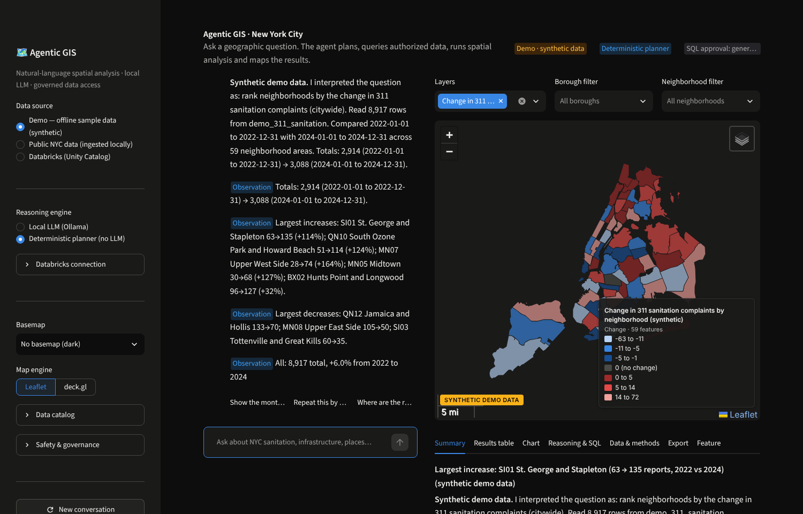
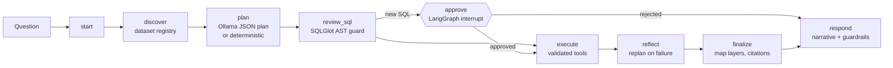

# Agentic GIS · Databricks

An open-source, LGND Earth Agent–inspired **agentic GIS** for New York City analysis. Ask a geographic
question in plain English; the agent finds authorized datasets, writes an analysis plan, shows you any
SQL for approval, runs real spatial analysis, maps the results and explains what they do — and don't — show.

* **Local first:** Streamlit UI, LangGraph orchestration, a local LLM through **Ollama**, DuckDB + Spatial,
  GeoPandas. No Genie, CARTO, LGND, Mapbox or paid LLM API required.
* **Databricks optional:** query authorized Unity Catalog tables on a SQL warehouse through the official
  `databricks-sql-connector`, with read-only, allowlisted, AST-validated SQL.
* **Works offline:** bundled sample data (real simplified NYC boundaries + clearly labeled **synthetic**
  complaints), vendored map JavaScript, and a deterministic planner when no LLM is running.



## Quick start (Windows PowerShell)

```powershell
winget install --id astral-sh.uv -e        # Python package manager (restart PowerShell afterwards)
winget install --id Ollama.Ollama -e       # local LLM runtime
git clone https://github.com/Cinesra97/agentic-gis-databricks.git
cd agentic-gis-databricks
git checkout claude/funny-mendel-8l1m9p    # until the work is merged into a main branch
uv sync --python 3.12                      # exact versions from uv.lock
Copy-Item .env.example .env                # optional: edit settings
ollama pull qwen2.5:7b                     # ~4.7 GB, Apache-2.0
uv run agentic-gis check                   # verifies DuckDB, Ollama, Databricks (optional)
uv run streamlit run app.py                # opens http://localhost:8501
```

No Ollama yet? Pick **Deterministic planner (no LLM)** in the sidebar; everything else works.
Full instructions, Databricks setup and troubleshooting: **[docs/SETUP_WINDOWS.md](docs/SETUP_WINDOWS.md)**.

## What you can ask

The agent is general purpose; these examples exercise different capabilities:

| Question | What the agent does |
|---|---|
| Find locations in NYC with repeated illegal dumping complaints. | Filters complaints → DBSCAN-style clustering (≥5 reports within 75 ft) → sized markers |
| Identify areas with high concentrations of derelict vehicle complaints. | Getis-Ord Gi* hot-spot test on a 1,000 ft grid + heat map |
| Find catch basins within 300 feet of specified streets. | Asks *which* streets, then buffers/`dwithin` join in EPSG:2263 |
| Identify streets with repeated missed sweeping complaints. | Snaps reports to the nearest street segment (≤100 ft), keeps segments with ≥3 |
| Show sanitation complaints near industrial properties. | Proximity join to industrial lots (default 500 ft) |
| Compare dumping patterns across NYC boroughs over time. | Time series by borough + trend statistics + chart |
| Find areas where multiple types of sanitation complaints overlap. | Grid cells with ≥3 distinct complaint types |
| Which neighborhoods have the largest increase in sanitation-related complaints? | Earliest vs latest full year per neighborhood, diverging choropleth |

Follow-ups keep context: “Now show only Brooklyn”, “Which of those are near industrial properties?”,
“What about by ZIP code?”.

## How it works



* The LLM never executes code. It returns a **JSON plan** of calls to registered tools
  (`filter_dataset`, `spatial_join`, `buffer_features`, `nearest_features`, `aggregate_by_geography`,
  `find_hotspots`, `analyze_temporal_patterns`, `compare_periods`, `generate_map_layer`, …), validated with
  Pydantic. Raw SQL (`query_local_data` / `query_databricks`) is allowed only as a single read-only SELECT
  over allowlisted tables and needs your approval.
* Results live in a per-session artifact store; map layers follow a **standard JSON schema**
  ([docs/MAP_LAYERS.md](docs/MAP_LAYERS.md)) rendered by Leaflet (Folium) or deck.gl (PyDeck).
* Answers separate **observations** (computed), **inferences** (interpretation) and **verified** findings
  (only from a dataset marked as a verification source). Complaints are never presented as confirmed
  violations; synthetic data is always labeled.

Details: [docs/ARCHITECTURE.md](docs/ARCHITECTURE.md).

## Data modes

| Mode | Data | Needs |
|---|---|---|
| **Demo** (default) | `sample_data/`: real simplified borough, community district and ZIP boundaries + synthetic 311-style complaints, catch basins, street corridors, industrial lots | nothing |
| **Public NYC data** | NYC Open Data (311, NTAs, PLUTO) ingested to `data/ingested/` with `uv run agentic-gis ingest …` | internet once |
| **Databricks** | Unity Catalog tables you register in `config/datasets.local.yaml` | SQL warehouse + read-only credentials |

Datasets are registered (allowlisted) in [`config/datasets.yaml`](config/datasets.yaml) with descriptions,
spatial columns, CRS, temporal columns, join keys, sensitivity and provenance — see
[docs/DATASETS.md](docs/DATASETS.md). The DSNY Unity Catalog tables are included as **disabled examples**;
they are never queried until an administrator enables them.

## Safety and governance (summary)

Read-only SQL validated on the AST (one statement, SELECT only, no DDL/DML/file IO/extension/secret/AI/HTTP
functions, allowlisted tables, sensitive-column blocking, enforced LIMIT), user approval for generated
SQL, query timeouts, DuckDB locked down after loading, no agent code execution, prompt-injection
sanitization, data-egress policy for LLM prompts (local LLM by default; external endpoints blocked unless
approved), secrets kept in environment / `.env` (git-ignored) and redacted from a JSONL audit log.
See [docs/SECURITY.md](docs/SECURITY.md) — including the known gaps (the Streamlit app has no built-in
login; deploy behind SSO).

## Repository layout

```text
app.py                      Streamlit entry point
agentic_gis/
  agent/      graph.py (LangGraph), state.py, tools.py (registry + tools), planner.py, llm.py,
              prompts.py, narrative.py (answers + guardrails), workspace.py (artifact store)
  connectors/ duckdb_engine.py, databricks_sql.py, nyc_open_data.py, base.py
  spatial/    geometry.py (CRS/units), operations.py, analysis.py (clusters, Gi*, trends)
  security/   sql_guard.py, audit.py, sanitize.py, policy.py
  imagery/    tiles.py, embeddings.py, search.py   (Phase 2 interfaces)
  ui/         chat.py, maps.py, layers.py (layer schema), results.py, sidebar.py, theme.py
  config/     settings.py, registry.py
  cli.py      agentic-gis command
config/datasets.yaml        dataset registry (allowlist)
sample_data/                offline demo data (see sample_data/README.md)
static/vendor/              vendored Leaflet assets (served by Streamlit)
scripts/                    build_sample_data.py, vendor_map_assets.py
notebooks/                  quickstart notebook, Unity Catalog read-only grants
tests/                      offline test suite (+ opt-in live Ollama/Databricks tests)
docs/                       setup, architecture, security, Databricks, datasets, layers, imagery, licenses
```

The requested top-level packages (`agent/`, `connectors/`, …) live under one importable package,
`agentic_gis/`, so names like `config` or `agent` cannot collide with other installed packages and the
project installs cleanly with `pip install -e .`. DuckDB/Databricks modules are named
`duckdb_engine.py` / `databricks_sql.py` to avoid shadowing the `duckdb` and `databricks` libraries.

## Development

```powershell
uv run pytest                 # 97 offline tests
uv run ruff check . ; uv run ruff format --check . ; uv run mypy agentic_gis app.py
uv run python scripts/build_sample_data.py   # rebuild sample data (needs GitHub raw access)
```

Testing status, including what could not be verified in the development environment (a live Ollama
model, a live Databricks warehouse, Windows itself): [docs/TESTING.md](docs/TESTING.md).
Current status and next steps: [HANDOFF.md](HANDOFF.md).

## Documentation

[Windows setup](docs/SETUP_WINDOWS.md) · [Architecture](docs/ARCHITECTURE.md) ·
[Security & governance](docs/SECURITY.md) · [Databricks](docs/DATABRICKS.md) · [Datasets](docs/DATASETS.md) ·
[Map layer schema](docs/MAP_LAYERS.md) · [Extending](docs/EXTENDING.md) ·
[Imagery roadmap](docs/IMAGERY_ROADMAP.md) · [Testing](docs/TESTING.md) · [Licenses](docs/LICENSES.md)

## License

Apache-2.0 (see [LICENSE](LICENSE)). Third-party components, data terms, basemap policies and model
licenses: [docs/LICENSES.md](docs/LICENSES.md).
