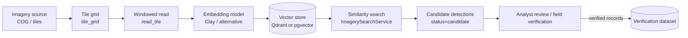

# Imagery intelligence — Phase 2 roadmap

Status: **interfaces and placeholder implementations only.** The MVP ships no imagery, no model
weights and no embedding index. The `search_imagery` tool returns `unavailable` and never
fabricates results.

## What exists today (`agentic_gis/imagery/`)

| Module | Implemented | Placeholder |
|---|---|---|
| `tiles.py` | `ImagerySource` model (COG / XYZ / WMS / STAC), `TileRef`, `tile_grid()` square tile footprints in a projected CRS (tested), `read_tile()` windowed COG reads via rasterio (optional `imagery` extra) | — |
| `embeddings.py` | `EmbeddingRecord` (tile id, footprint, source id, acquisition date, model name/version, vector), `EmbeddingModel` protocol, `InMemoryEmbeddingStore` (cosine, tested), `QdrantEmbeddingStore` (optional `vector` extra) | `ClayEmbeddingModel.embed()` raises `NotConfiguredError` |
| `search.py` | `ImagerySearchService` (status + vector similarity), `CandidateDetection` with `status="candidate"` and `verification="unverified"` | `get_default_search_service()` returns an unconfigured service |

Design rules already enforced in code:

* Original imagery is never copied into the vector store; records reference `source_id` + footprint.
* Every embedding stores geometry, source imagery, acquisition date and model version.
* Detections are **candidates for review**. A candidate can only become a verified finding through an
  authoritative verification dataset (e.g. field inspection records marked `verification_source: true`).
* The narrative guardrails rewrite any claim that a location *is* an illegal dumping site.

## Data sources to evaluate

| Source | Resolution | Fit |
|---|---|---|
| NYC orthophotography (NYC OTI, multiple years) | ~6 in – 1 ft | Best candidate for dumping piles, bulky items, vehicles. Confirm licensing, access path (tiles vs. COG), and acquisition dates. |
| NAIP (USDA) | ~0.6 m, every 2–3 years | Useful for change detection of larger features; too coarse for small piles. |
| Sentinel-2 | 10 m | **Not sufficient** for small illegal dumping piles or individual vehicles. Only suitable for large land-cover change. |
| Commercial high-resolution | 0.3–0.5 m | Requires contracts and licensing review. |

## Proposed pipeline

1. **Register imagery** as `ImagerySource` entries (YAML, like datasets) with license, acquisition date,
   resolution and CRS.
2. **Tile** areas of interest with `tile_grid()` (e.g. 64–128 m tiles for 6-inch imagery). Store tile
   footprints as GeoParquet or a Unity Catalog table.
3. **Embed** tiles in a batch job (Databricks Job with GPU, or a workstation), not inside the Streamlit app.
   Clay v1.x needs per-band wavelengths, ground sample distance, time and location metadata; verify the
   model card's license and normalization statistics before use.
4. **Index** vectors in Qdrant (Apache-2.0) or PostgreSQL + pgvector (PostgreSQL license), or Databricks
   Vector Search if approved. Payload = `EmbeddingRecord` fields without the vector.
5. **Search** by example (“find tiles similar to this confirmed dumping location”), constrained by bounding
   box and acquisition date. Results are `CandidateDetection` objects shown as a separate map layer.
6. **Compare dates** by embedding the same footprint across acquisitions and ranking embedding distance
   (change candidates), never as proof of change.
7. **Evaluate** precision/recall against labeled, verified locations before any operational use; publish
   the evaluation alongside the model version.

## Integrating with the agent

* Replace `get_default_search_service()` with a configured service (store + model) behind a setting such as
  `AGIS_IMAGERY_INDEX_URL`.
* Extend `search_imagery` arguments with `example` (a step id holding confirmed locations) and
  `acquisition_date` filters; return an artifact of candidate footprints so the existing map-layer schema
  renders them.
* Add `imagery_tile` tool to fetch a preview PNG for a candidate (rasterio read → PNG bytes), shown in the
  Feature panel.
* Keep imagery results out of LLM prompts except for counts and scores.

## Governance checklist before enabling

- [ ] Imagery license allows the intended analysis and storage of derived embeddings
- [ ] Model weights license reviewed (code license ≠ weights license)
- [ ] Evaluation on NYC imagery with verified labels; false-positive rate documented
- [ ] UI labels every imagery layer “candidate — not verified”
- [ ] Privacy review (people, license plates, private property in sub-meter imagery)
